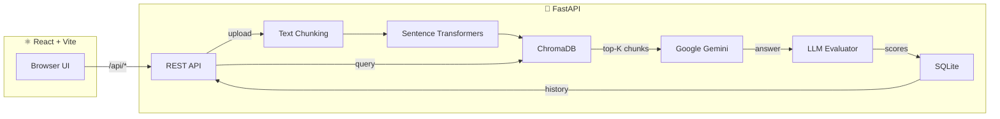

# 🧠 RAG Answer Eval

**An end-to-end Retrieval-Augmented Generation pipeline with built-in answer quality evaluation.**

Upload your documents → ask questions grounded in real content → get AI-generated answers automatically scored for relevance, faithfulness, precision, and completeness — all in one platform.

---

## 🔗 Live Demo

Deployed on Render — [rag-answer-eval.onrender.com](https://rag-answer-eval.onrender.com)
> [!NOTE]
> The current `render.yaml` requests a paid Standard instance and a 2 GB persistent disk. The first deployment can take longer while Python dependencies are installed; the embedding model is downloaded on the first document upload or query.

---

## ✨ Key Features

| Feature | Description |
|---|---|
| 📄 **Document Upload** | Upload PDF, TXT, or Markdown files. Text is extracted, cleaned, and split into overlapping chunks. |
| 🔍 **Semantic Search** | Chunks are embedded using Sentence Transformers (`all-MiniLM-L6-v2`) and indexed in ChromaDB with cosine similarity. |
| 🤖 **Grounded Answers** | Questions are answered using Google Gemini, strictly grounded in retrieved document context — no hallucination. |
| 📊 **Auto Evaluation** | Every answer is automatically scored (0–100) on 5 dimensions by a separate LLM evaluation call. |
| 🗂️ **Knowledge Base** | Manage uploaded documents — view chunk counts, file sizes, indexing status. Delete anytime. |
| 📈 **Evaluation Lab** | Aggregated quality metrics across all runs — average scores, groundedness trends, latency tracking. |
| 📜 **Run History** | Every pipeline execution is persisted in SQLite with full answer, scores, reasoning, and issues. |

---

## 🏗️ Architecture



### How the RAG Pipeline Works

```
┌──────────┐    ┌──────────────┐    ┌────────────┐    ┌────────────┐    ┌────────────┐
│  Question │───▶│  Embed Query │───▶│ Vector     │───▶│   Gemini   │───▶│   Gemini   │
│  (user)   │    │  (MiniLM)    │    │ Search     │    │  Generate  │    │  Evaluate  │
└──────────┘    └──────────────┘    │ (ChromaDB) │    │  Answer    │    │  Quality   │
                                     └────────────┘    └────────────┘    └────────────┘
                                      ↓ top-K chunks    ↓ grounded       ↓ 5 scores
                                      with similarity    answer           + verdict
                                      scores                              + reasoning
```

**Step-by-step:**

1. **User asks a question** via the Playground UI
2. **Question is embedded** into a 384-dim vector using `all-MiniLM-L6-v2`
3. **ChromaDB retrieves** the top-K most similar document chunks (cosine similarity, configurable threshold)
4. **Google Gemini generates** a grounded answer using only the retrieved context — refuses to answer if context is insufficient
5. **A second Gemini call evaluates** the answer, producing structured JSON scores:
   - `answer_relevance` — Does the answer address the question?
   - `faithfulness` — Are claims supported by the context?
   - `context_precision` — Are retrieved passages relevant?
   - `completeness` — Is important information covered?
   - `overall_score` — Balanced quality score (0–100)
6. **Everything is persisted** in SQLite — question, answer, chunks, scores, verdict, reasoning, and latency

> [!IMPORTANT]
> Evaluation scores are LLM-generated quality signals, not guaranteed ground truth. Always review the source passages and answer before relying on a score.

---

## 🛠️ Technology Stack

| Layer | Technology | Purpose |
|---|---|---|
| **Frontend** | React 18, Vite 5, Lucide React | Single-page UI with 4 tabs — Playground, Knowledge Base, Evaluation Lab, Runs |
| **Backend API** | Python 3.11, FastAPI, Uvicorn | RESTful API serving documents, queries, evaluations, and stats |
| **Answer Generation** | Google Gemini API (`gemini-2.5-flash`) | Document-grounded answer generation with injection-resistant prompting |
| **Answer Evaluation** | Google Gemini API (same model) | Structured JSON evaluation with 5 quality dimensions |
| **Embeddings** | Sentence Transformers `all-MiniLM-L6-v2` | 384-dimensional dense embeddings, normalized for cosine similarity |
| **Vector Store** | ChromaDB (persistent) | HNSW-indexed vector database with cosine distance metric |
| **Metadata Store** | SQLite | Document metadata, evaluation history, dashboard statistics |
| **PDF Extraction** | pypdf | Text extraction from PDF pages (non-OCR) |
| **Validation** | Pydantic v2 | Request/response schema validation |
| **Deployment** | Docker (multi-stage), Render Blueprint | Frontend built at image-build time, served by FastAPI in production |

---

## 📁 Project Structure

```
RAG-Answer-Eval/
├── .env.example                  # Backend environment template (copy to .env)
├── Dockerfile                    # Multi-stage — builds frontend, runs backend
├── render.yaml                   # Render Blueprint — service + persistent disk
│
├── backend/
│   ├── app/
│   │   ├── main.py               # FastAPI app, route registration, static mount
│   │   ├── config.py             # All env vars, validation, path resolution
│   │   ├── schemas.py            # Pydantic models for requests/responses
│   │   ├── routes/
│   │   │   ├── documents.py      # Upload, list, delete documents
│   │   │   ├── rag.py            # Query → retrieve → generate → evaluate
│   │   │   ├── evaluations.py    # Evaluation history and detail lookup
│   │   │   └── stats.py          # Dashboard statistics endpoint
│   │   └── services/
│   │       ├── chunking.py       # Text cleanup + overlapping chunk splitter
│   │       ├── embeddings.py     # Sentence Transformer model + encoding
│   │       ├── llm.py            # Gemini answer generation + evaluation
│   │       ├── storage.py        # SQLite persistence (documents + evaluations)
│   │       └── vector_store.py   # ChromaDB indexing + cosine similarity search
│   ├── tests/
│   │   ├── test_chunking.py      # Chunk splitting + edge cases
│   │   ├── test_documents.py     # Upload/list/delete + text extraction
│   │   └── test_health.py        # Health check, validation, defaults
│   ├── requirements.txt          # Runtime Python dependencies
│   └── requirements-dev.txt      # Runtime + pytest/httpx for testing
│
└── frontend/
    ├── index.html                # HTML entry point
    ├── vite.config.js            # Dev proxy → localhost:8000
    ├── package.json              # React 18, Vite 5, Lucide React
    └── src/
        ├── main.jsx              # Entire UI — 4 tabs, all components
        └── styles.css            # Complete stylesheet
```

---

## 🚀 Getting Started

### Prerequisites

| Requirement | Version |
|---|---|
| Python | 3.11+ |
| Node.js | 20+ (22 recommended) |
| npm | Comes with Node.js |
| Google Gemini API Key | [Get one here](https://aistudio.google.com/apikey) |

> [!TIP]
> The first run downloads the Sentence Transformers model (~90 MB). Allow extra time and network access.

### 1. Clone & Configure

```bash
git clone https://github.com/anuragverma4895/RAG-Answer-Eval.git
cd RAG-Answer-Eval
```

Copy the environment template and add your Gemini API key:

```bash
cp .env.example .env     # macOS / Linux
```

```powershell
Copy-Item .env.example .env     # Windows PowerShell
```

Edit `.env` and set your key:

```env
GEMINI_API_KEY=your_actual_api_key_here
```

> [!CAUTION]
> Never commit the `.env` file. It is already in `.gitignore`.

### 2. Backend Setup

**macOS / Linux:**

```bash
python3 -m venv .venv
.venv/bin/python -m pip install --upgrade pip
.venv/bin/python -m pip install -r backend/requirements-dev.txt
```

**Windows PowerShell:**

```powershell
python -m venv .venv
.\.venv\Scripts\python.exe -m pip install --upgrade pip
.\.venv\Scripts\python.exe -m pip install -r backend\requirements-dev.txt
```

### 3. Frontend Setup

```bash
cd frontend
npm install
cd ..
```

No frontend `.env` needed — Vite proxies `/api` requests to the backend in dev mode.

### 4. Run the App

Start each in a separate terminal from the repo root:

**Terminal 1 — Backend:**

```bash
cd backend
../.venv/bin/python -m uvicorn app.main:app --reload          # macOS / Linux
```

```powershell
Set-Location backend
..\\.venv\\Scripts\\python.exe -m uvicorn app.main:app --reload   # Windows
```

**Terminal 2 — Frontend:**

```bash
cd frontend
npm run dev
```

Open **http://localhost:5173** in your browser. The backend API runs at **http://localhost:8000**.

| URL | Purpose |
|---|---|
| `http://localhost:5173` | Frontend UI (Vite dev server) |
| `http://localhost:8000/docs` | Interactive API documentation (Swagger) |
| `http://localhost:8000/api/health` | Backend health check |

---

## 🔧 Environment Variables

Configure in the repository-root `.env` file. All settings have working defaults except `GEMINI_API_KEY`.

| Variable | Purpose | Default |
|---|---|---|
| `GEMINI_API_KEY` | **Required.** Google Gemini API key | — |
| `GEMINI_MODEL` | Gemini model for generation and evaluation | `gemini-2.5-flash` |
| `EMBEDDING_MODEL` | Sentence Transformers model name | `all-MiniLM-L6-v2` |
| `VECTOR_DB_PATH` | ChromaDB persistence directory | `./backend/data/chroma` |
| `SQLITE_PATH` | SQLite database file path | `./backend/data/rag_eval.db` |
| `CHUNK_SIZE` | Max characters per chunk | `800` |
| `CHUNK_OVERLAP` | Overlap between adjacent chunks (chars) | `150` |
| `TOP_K` | Default number of retrieved chunks (1–10) | `5` |
| `SIMILARITY_THRESHOLD` | Minimum cosine similarity for retrieval (0–1) | `0.25` |
| `MAX_UPLOAD_MB` | Maximum upload file size in MiB | `15` |

> [!NOTE]
> Relative data paths are resolved from the repository root, not from the current terminal directory. On Render, `render.yaml` maps these to the persistent disk at `/var/data`.

---

## 📡 API Reference

All endpoints are prefixed with `/api`. Full interactive docs available at `/docs` (Swagger UI).

### Endpoints

| Method | Endpoint | Description |
|---|---|---|
| `GET` | `/api/health` | Health check — returns `{"status": "ok"}` |
| `GET` | `/api/stats` | Dashboard statistics — document count, chunks, avg score, groundedness, latency |
| `GET` | `/api/documents` | List all indexed and failed documents |
| `POST` | `/api/documents/upload` | Upload and index a document (multipart form, field: `file`) |
| `DELETE` | `/api/documents/{document_id}` | Delete a document and its indexed chunks |
| `POST` | `/api/rag/query` | Run the full RAG pipeline — retrieve, generate, evaluate |
| `GET` | `/api/evaluations` | List recent saved evaluations (last 20) |
| `GET` | `/api/evaluations/{evaluation_id}` | Get a specific saved evaluation |

### Example: Run a Query

**Request:**

```bash
curl -X POST http://localhost:8000/api/rag/query \
  -H "Content-Type: application/json" \
  -d '{"question": "What is the refund policy?", "top_k": 5, "similarity_threshold": 0.25}'
```

**Response (simplified):**

```json
{
  "evaluation_id": 42,
  "question": "What is the refund policy?",
  "answer": "Refunds are available within 30 days of purchase...",
  "model": "gemini-2.5-flash",
  "latency_ms": 2340,
  "retrieved_context": [
    {
      "document_name": "policy.pdf",
      "chunk_index": 3,
      "page_number": 2,
      "similarity": 0.8721,
      "text": "Refunds are available within 30 days..."
    }
  ],
  "evaluation": {
    "answer_relevance": 95,
    "faithfulness": 92,
    "context_precision": 88,
    "completeness": 85,
    "overall_score": 90,
    "verdict": "Excellent",
    "reasoning": "The answer directly addresses the refund question using information from the source context.",
    "issues": []
  }
}
```

> [!NOTE]
> If no passage meets the similarity threshold, the API returns a `404` instead of generating an ungrounded answer.

---

## 🧪 Running Tests

Run from the `backend/` directory so the `app` package resolves correctly:

**macOS / Linux:**

```bash
cd backend
../.venv/bin/python -m pytest tests -v
```

**Windows PowerShell:**

```powershell
Set-Location backend
..\\.venv\\Scripts\\python.exe -m pytest tests -v
```

**What's tested:**

| Test File | Coverage |
|---|---|
| `test_chunking.py` | Text splitting, overlap, boundary detection, empty input, invalid params |
| `test_documents.py` | UTF-8 extraction, BOM removal, bad PDF handling, upload→list→delete flow |
| `test_health.py` | Health endpoint, unsupported file rejection, blank question validation, default config |

> [!TIP]
> End-to-end queries require a valid `GEMINI_API_KEY` and network access to the Gemini API.

---

## 🐳 Docker

The project uses a multi-stage Dockerfile:

1. **Stage 1** (`node:22-alpine`): Builds the React/Vite frontend into static files.
2. **Stage 2** (`python:3.11-slim`): Installs backend dependencies, copies the API and built frontend, and starts Uvicorn.
3. PyTorch is installed from the official CPU-only wheel index because the Render service does not have an NVIDIA GPU; this avoids adding the large CUDA/NVIDIA package stack.
4. Sentence Transformers is imported only when an upload or query needs embeddings, so API startup and the health check do not wait for PyTorch/model initialization. The embedding model then runs explicitly on CPU.

```bash
# Build
docker build -t rag-answer-eval .

# Run (set your API key)
docker run -p 10000:10000 -e GEMINI_API_KEY=your_key rag-answer-eval
```

Open **http://localhost:10000** — both the UI and API are served from the same origin.

---

## ☁️ Deploy to Render

The project includes a `render.yaml` Blueprint for one-click deployment:

1. Push the `main` branch to GitHub
2. In Render → **New → Blueprint** (not "New Web Service")
3. Select the repo `anuragverma4895/RAG-Answer-Eval`, branch `main`
4. Review the resources in `render.yaml`
5. Enter `GEMINI_API_KEY` when prompted → Apply
6. Wait for build + `/api/health` check → Open the service URL

**What the Blueprint creates:**

| Resource | Configuration |
|---|---|
| Web Service | Docker, Standard plan, Singapore region |
| Persistent Disk | 2 GB at `/var/data` — stores ChromaDB, SQLite, model cache |
| Health Check | `GET /api/health` |
| Auto Deploy | On push to `main` |

> [!WARNING]
> The Standard plan and persistent disk are **paid** Render resources. Review pricing before confirming.

**Post-deployment verification:**

```
✅ GET https://YOUR-SERVICE.onrender.com/api/health → {"status": "ok"}
✅ Upload a small text file in Knowledge Base
✅ Ask a question grounded in that file
✅ Verify answer + evaluation scores appear
✅ Delete the test file to confirm deletion works
```

---

## 🔒 Security Notes

- **Prompt injection resistance**: Both the generation and evaluation prompts tag user-supplied content inside XML delimiters (`<question>`, `<context>`, `<answer>`) and instruct the model to treat them as data, not instructions
- **File validation**: Only `.pdf`, `.txt`, `.md`, `.markdown` extensions are accepted. File size is capped at `MAX_UPLOAD_MB`
- **No CORS needed**: In production (Docker/Render), the frontend and API share the same origin

---

## ⚠️ Known Limitations

- **Scanned PDFs** with image-only pages do not contain extractable text — OCR is not included
- **Gemini dependency** — answer generation and scoring require API access, quota, and the selected model being available
- **LLM evaluation variance** — scores are AI judgements and can vary between runs; they are not a substitute for a manually labelled benchmark
- **Single embedding model** — currently only supports Sentence Transformers models; no OpenAI or Cohere embeddings
- **No authentication** — the API is open; add auth middleware for production use with sensitive data
- **Local data persistence** — data lives in `backend/data/`; back it up before removing the local environment

---

## 📝 License

This project is open-source. See the repository for license details.

---

<p align="center">
  Built with ❤️ using FastAPI, React, ChromaDB, and Google Gemini
</p>
